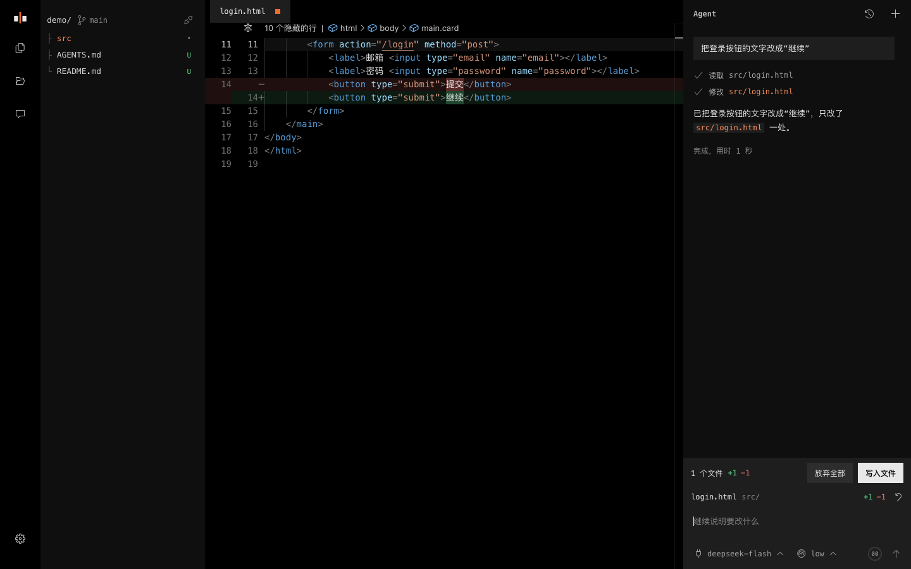

# Caret

[简体中文](README.md) | English

An ultralight coding agent in your browser. It has three tools: `read`, `write` and `edit`.

Caret runs in your browser, with nothing to install and no account. Open a local folder and describe the change. The Agent finds the code and makes the edit. Changes stay in the editor until you have read the diff and applied them to disk.

Try it at <https://caret.tenon.asia/>



## What it is for

Copy, configuration, styles, documentation and small bugs: changes you can judge by reading the diff.

Caret has no bash, runs no commands and runs no tests. When a change has to be run to be sure, it tells you what to check.

| Tool | What it does |
| --- | --- |
| `read` | Reads files, lists directories and searches content |
| `write` | Creates a file, or rewrites a whole file |
| `edit` | Replaces an exact piece of text in a file, and refuses when it matches more than one place |

## Getting started

1. Open <https://caret.tenon.asia/> in desktop Chrome or Edge. Other browsers cannot access local folders
2. Choose a model service in Settings and enter your API key. DeepSeek, Kimi, Qwen, OpenAI and OpenRouter are built in, and you can enter a custom OpenAI-compatible URL
3. Open or drop a folder, and describe the change
4. Read the diff, then click Apply or press `Ctrl/Cmd+Enter`. You can undo an apply

Caret is web only, with no mobile app: it reads and writes a local folder directly, and only desktop Chrome and Edge support that today (the File System Access API).

## Features

- **Editing and review**: A Monaco editor where you and the Agent work on the same content. Diffs can be inline or side by side, and you can edit them directly
- **Safe apply**: Apply and undo both check the disk first, and warn you if another program changed a file
- **File tree**: Filtered by `.gitignore`, with the Git branch and change marks. Git status is read-only: Caret does not commit or write to `.git`
- **Models**: Model lists and reasoning levels come from each provider's API. Choose defaults in Settings, and switch for the current conversation in the input bar
- **History**: Conversations are saved per project and can be resumed, continued and deleted
- **Settings**: A side navigation with Model, Agent, Editor, Files, Appearance, Data and About

## Memory

Caret has no hidden memory. There are three things, and you can see all of them:

- **Project rules**: `AGENTS.md` or `CLAUDE.md` is read at run time. When you state a lasting rule, the Agent adds a line, and you review it like any other diff. You can turn this off in Settings
- **Global instructions**: You write these in Settings. They apply to every project and the Agent does not change them. If they disagree with project rules, the project rules win
- **Conversations**: Stored in this browser's IndexedDB. You can delete them, or turn saving off

## Context

The system prompt and tool definitions take about 700 tokens, with no file list. The Agent reads what it needs.

The ring in the input bar shows how much context is used. 100% is the compaction size in Settings, about 100,000 tokens by default. At 100%, Caret clears older tool results. They can be read again, so compaction does not call the model to write a summary.

## Where your data goes

- Caret has no accounts and no application server
- Your requests, global instructions and the file contents the Agent reads go only to the model service you configured
- Common secret files, such as `.env`, private keys and login files for cloud and package tools, are not read
- API keys, settings and conversations are stored only in this device's browser, and you can delete all of them on the Data page in Settings
- When you use the hosted page, the server records access logs with the time, IP address and page visited, without URL parameters, and deletes them after 6 months

### Data inventory

| Data | Source | Purpose | Where and how long | How to delete |
| --- | --- | --- | --- | --- |
| Model service settings and API key | You enter them in Settings | Calling the model service you chose | This device's IndexedDB, until you delete it | Data page in Settings |
| Preferences and global instructions | You enter them in Settings | Running with your preferences | This device's IndexedDB, until you delete it | Reset settings, or the Data page |
| Conversations, including file contents the Agent read | Your conversations with the Agent | Resuming and continuing conversations | This device's IndexedDB, up to 100 per project | Delete in History, or the Data page; saving can be turned off |
| Prompts you sent | The input bar | Recalling them with the arrow keys | This device's IndexedDB, up to 200 per project | Data page |
| Folder access and open tabs | The folder you chose | Restoring them next time | This device's IndexedDB, until you delete it | Revoke folder access, or the Data page |
| Theme, language and panel widths | Settings and the interface | Showing your preferences as the page opens | This device's localStorage, until you delete it | Data page |
| Requests, global instructions, and file contents and paths the Agent reads | Your conversations | Doing the task | The model service you chose, under its privacy policy | Under that provider's rules |
| Access logs: time, IP address, page visited (without parameters), status and duration | Visiting the hosted page | Network security | The server, deleted automatically after 6 months | Deleted automatically |

## Development

There is no build step and no runtime dependency. The source is what runs in production. Monaco lives in `vendor/` and is served from the same origin, so the page loads no third-party scripts.

The page's own scripts and styles have no content hash in their names, because there is no build step to add one. They are served with `no-cache`, so the browser checks with the server for updates each time. Monaco sits in a versioned folder, `vendor/monaco-<version>/`, with a long cache lifetime.

```bash
python3 -m http.server 8000             # Run locally, then open http://localhost:8000
node --test                             # Run the tests, with Node.js 22 or later
bash deploy/release.sh                  # Release: scan for secrets, check dependency advisories, test, upload and check the live site
bash deploy/release.sh maintenance on   # Show the maintenance page; off to restore
```

```text
*.html                 Page entry point, error pages and maintenance page
CHANGELOG.md           Changelog (in Chinese)
src/
  main.js              Startup
  app/                 Controller, storage, preferences and constants
  agent/               Agent loop, model calls and the three tools
  chat/                Conversation UI, input bar, change review and history
  editor/              Monaco, tabs and pending changes
  file-tree/           File tree, ignore rules and Git status
  settings/            Settings dialog
  i18n/                Chinese and English copy, and legal text
css/                   Styles, starting from style.css
assets/                Static assets such as the share image
tests/                 Tests, matching the modules in src and the scripts in deploy
docs/                  Design guidelines, security self-check and the README screenshot
vendor/                Monaco 0.52.2, from min/vs in the npm package, with only the Simplified Chinese language pack
deploy/                Release and cleanup scripts, Caddy config and the server's host key
```

Read the [design guidelines](docs/design-guidelines.md) (in Chinese) before changing the interface. See the [changelog](CHANGELOG.md) for changes between versions and [docs/security.md](docs/security.md) for the security self-check (both in Chinese).

## License

[MIT](LICENSE). The editor is [Monaco Editor](https://github.com/microsoft/monaco-editor), with the license in [vendor/monaco-0.52.2](vendor/monaco-0.52.2). Icons are from [vscode-codicons](https://github.com/microsoft/vscode-codicons), with the license in [css/codicons](css/codicons).
