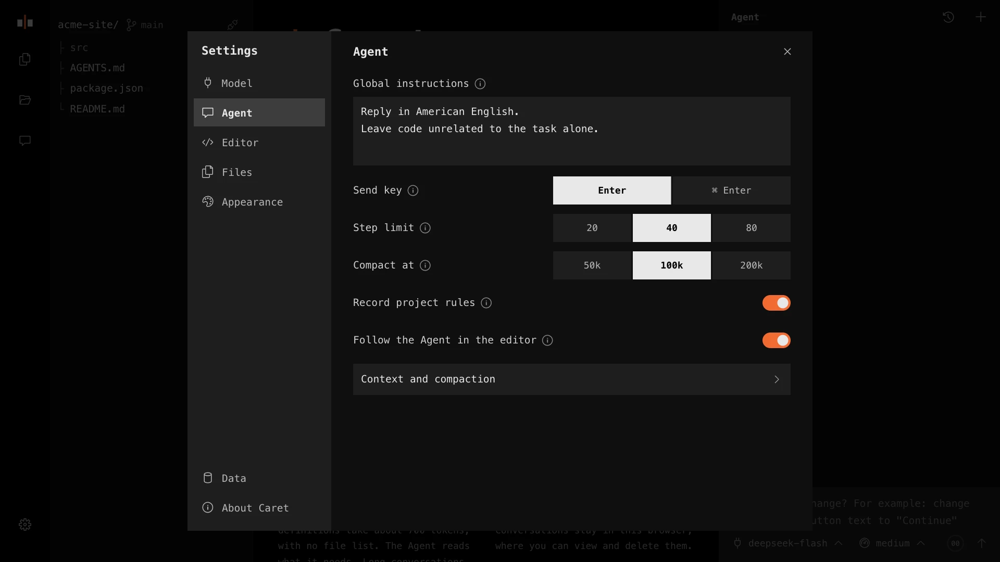

  

<h1 align="center">Caret</h1>

An ultralight coding agent in your browser

English | <a href="README.zh-CN.md">简体中文</a>

  
  

<picture>
  <source media="(prefers-color-scheme: dark)" srcset="docs/assets/review-en-dark.webp">
  
</picture>

Caret runs in your browser, with nothing to install and no account. Open a local folder and describe the change. The Agent finds the code and edits it in the editor, and nothing reaches the disk until you have read the diff and applied it.

## What it does

### Three tools, no shell

The Agent has `read`, `write` and `edit`. `read` reads files, lists directories and searches content; `write` creates a file or rewrites a whole file; `edit` replaces an exact piece of text, and refuses when it matches more than one place. Caret runs no commands and no tests, so it suits changes you can judge by reading the diff: copy, configuration, styles, documentation and small bugs. When a change has to be run to be sure, it tells you what to check.

### Read the diff before it reaches the disk

You and the Agent work on the same content in a Monaco editor. Diffs can be inline or side by side, and you can edit them directly. Apply and undo both check the disk first, and warn you if another program changed a file after Caret read it. The file tree is filtered by `.gitignore` and shows the Git branch and change marks. Git status is read-only: Caret does not commit or write to `.git`.

### No hidden memory

There are three things, and you can see all of them. Project rules are `AGENTS.md` and `CLAUDE.md`, read at run time; when you state a lasting rule, the Agent adds a line, and you review it like any other diff. Global instructions are yours to write in Settings, and apply to every project. Conversations are saved per project in this browser, where you can resume or delete them, or turn saving off.

### Your model and your key

DeepSeek, Kimi, Qwen, OpenAI and OpenRouter are built in, and you can enter a custom OpenAI-compatible URL. Model lists and reasoning levels come from each provider's `/models` API. Choose defaults in Settings, and switch for the current conversation in the input bar.

### A small context

The system prompt and tool definitions take about 700 tokens, with no file list: the Agent reads what it needs. The ring in the input bar shows how much context is used, and 100% is the compaction size in Settings, about 100,000 tokens by default. At 100%, Caret clears older tool results. They can be read again, so compaction does not call the model to write a summary.

## Quick start

1. Open <https://caret.tenonai.cn/> in desktop Chrome or Edge. Other browsers cannot access local folders
2. Choose a model service in Settings and enter your API key
3. Open or drop a folder, and describe the change
4. Read the diff, then click Apply or press `Ctrl/Cmd+Enter`. You can undo an apply

Caret is web only, with no mobile app: it reads and writes a local folder directly, and only desktop Chrome and Edge support that today (the File System Access API). To run it locally, see [CONTRIBUTING.md](CONTRIBUTING.md).

## Documentation

- [Changelog](CHANGELOG.md)
- [Contributing](CONTRIBUTING.md): running locally, tests and the project layout
- [Project conventions](AGENTS.md) and [design guidelines](docs/design-guidelines.md)
- [Security self-check](docs/security.md)

The changelog, conventions, design guidelines and security self-check are in Chinese.

## Where your data goes

- Caret has no accounts and no application server
- Your requests, global instructions and the file contents the Agent reads go only to the model service you configured
- Common secret files, such as `.env`, private keys and login files for cloud and package tools, are not read
- API keys, settings and conversations are stored only in this device's browser, and you can delete all of them on the Data page in Settings
- When you use the hosted page, the server records access logs with the time, IP address and page visited, without URL parameters, and deletes them after 6 months

Data inventory

| Data | Source | Purpose | Where and how long | How to delete |
| --- | --- | --- | --- | --- |
| Model service settings and API key | You enter them in Settings | Calling the model service you chose | This device's IndexedDB, until you delete it | Data page in Settings |
| Preferences and global instructions | You enter them in Settings | Running with your preferences | This device's IndexedDB, until you delete it | Reset settings, or the Data page |
| Conversations, including file contents the Agent read | Your conversations with the Agent | Resuming and continuing conversations | This device's IndexedDB, up to 100 per project | Delete in History, or the Data page; saving can be turned off |
| Prompts you sent | The input bar | Recalling them with the arrow keys | This device's IndexedDB, up to 200 per project | Data page |
| Folder access and open tabs | The folder you chose | Restoring them next time | This device's IndexedDB, until you delete it | Revoke folder access, or the Data page |
| Theme, language and panel widths | Settings and the interface | Showing your preferences as the page opens | This device's localStorage, until you delete it | Data page |
| Requests, global instructions, and file contents and paths the Agent reads | Your conversations | Doing the task | The model service you chose, under its privacy policy | Under that provider's rules |
| Access logs: time, IP address, page visited (without parameters), status and duration | Visiting the hosted page | Network security | The server, deleted automatically after 6 months | Deleted automatically |

## Security

Please report security problems privately, as described in [SECURITY.md](SECURITY.md), and not in a public issue.

## Contributing

Bug reports, ideas and pull requests are welcome. Read [CONTRIBUTING.md](CONTRIBUTING.md) first. Everyone taking part follows the [Code of Conduct](CODE_OF_CONDUCT.md).

## License

[MIT](LICENSE). Copyright (c) 2025-2026 Changsha Tenon Artificial Intelligence Technology Co., Ltd.

The editor is [Monaco Editor](https://github.com/microsoft/monaco-editor), with the license in [vendor/monaco-0.52.2](vendor/monaco-0.52.2). Icons are from [vscode-codicons](https://github.com/microsoft/vscode-codicons), with the license in [css/codicons](css/codicons).

---

  Publisher&emsp;<a href="https://tenonai.cn/products/caret/"> <b>Tenon AI</b></a>

