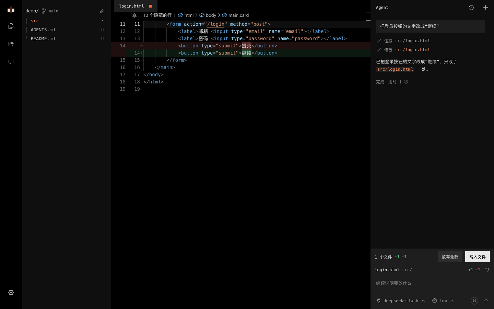

# Caret

简体中文 | [English](README.en.md)

只有三个工具的 Coding Agent：`read`、`write`、`edit`。

Caret 运行在浏览器里，不用安装，也不用账号。打开一个本地文件夹，说明要改什么，Agent 找到代码并做出改动。改动先留在编辑器里，你看完 diff 再写入磁盘。

线上地址：<https://caret.tenon.asia/>



## 适合做什么

改文案、配置、样式、文档和小 bug，这些改动看 diff 就能判断对错。

Caret 不提供 bash，不执行命令，也不运行测试。需要跑起来才能确认的改动，它会告诉你该检查什么。

| 工具 | 作用 |
| --- | --- |
| `read` | 读取文件、列出目录、搜索内容 |
| `write` | 新建文件，或重写整个文件 |
| `edit` | 精确替换文件里的一段文字，匹配到多处时拒绝修改 |

## 开始使用

1. 用桌面版 Chrome 或 Edge 打开 <https://caret.tenon.asia/>。其他浏览器不能访问本地文件夹
2. 在设置里选择模型服务，填写 API Key。内置 DeepSeek、Kimi、Qwen、OpenAI 和 OpenRouter，也可以填写 OpenAI 兼容的自定义地址
3. 打开或拖入一个文件夹，说明要改什么
4. 看完 diff，点“写入文件”或按 `Ctrl/Cmd+Enter`。写入后可以撤销

## 功能

- **编辑和审阅**：Monaco 编辑器，Agent 和你改的是同一份内容。Diff 支持行内和并排，可以直接编辑
- **写入保护**：写入和撤销前都检查磁盘内容，文件被其他程序改过时先提示
- **文件树**：按 `.gitignore` 过滤，显示 Git 分支和改动标记。Git 状态只读，不提交，也不写入 `.git`
- **模型**：模型列表和推理档位都来自服务商的接口，设置里选默认值，输入栏可以为当前对话切换
- **历史记录**：按项目保存对话，可以恢复、继续和删除
- **设置**：左侧导航分为模型、Agent、编辑器、文件、外观、数据和关于

## 记忆

Caret 没有隐藏的记忆，只有三样你能看到的东西：

- **项目规则**：运行时读取 `AGENTS.md` 或 `CLAUDE.md`。你说出长期规则时，Agent 加一行，走同样的 diff 审阅。这一行为可以在设置里关闭
- **全局指令**：你写在设置里，在所有项目生效，Agent 不会修改。和项目规则冲突时以项目规则为准
- **对话记录**：保存在这个浏览器的 IndexedDB 里，可以删除，也可以关闭保存

## 上下文

系统提示词和工具定义约 700 token，不带文件列表，Agent 需要什么再读什么。

输入栏的小圈显示上下文已用比例，100% 是设置里的压缩线，默认约 10 万 token。到 100% 时，Caret 清理较早的工具结果，这些内容可以重新读取，所以压缩不调用模型写摘要。

## 数据去向

- Caret 没有账号，也没有应用服务器
- 你的需求、全局指令和 Agent 读取的文件内容只发给你配置的模型服务
- `.env`、私钥、云服务和包管理工具的登录文件等常见密钥文件不会被读取
- API Key、设置和对话记录只保存在这台设备的浏览器里，可以在设置的数据页全部清除

## 开发

没有构建步骤，也没有依赖，源码就是线上运行的代码。

```bash
python3 -m http.server 8000   # 本地运行，然后打开 http://localhost:8000
node --test                   # 运行测试，需要 Node.js 22 或更高版本
```

```text
index.html, 404.html   页面入口
src/
  main.js              启动
  app/                 控制器、存储、偏好和常量
  agent/               Agent 循环、模型调用和三个工具
  chat/                对话界面、输入栏、审阅改动和历史记录
  editor/              Monaco、标签页和未写入的改动
  file-tree/           文件树、忽略规则和 Git 状态
  settings/            设置对话框
  i18n/                中英文文案和法律文本
css/                   样式，入口是 style.css
assets/                分享图等静态资源
tests/                 测试，和 src 的模块对应
docs/                  设计规范和 README 截图
deploy/                发布脚本和 Caddy 配置
```

修改界面前先看[设计规范](docs/design-guidelines.md)。

## 许可证

[MIT](LICENSE)。图标来自 [vscode-codicons](https://github.com/microsoft/vscode-codicons)，许可证见 [css/codicons](css/codicons)。
