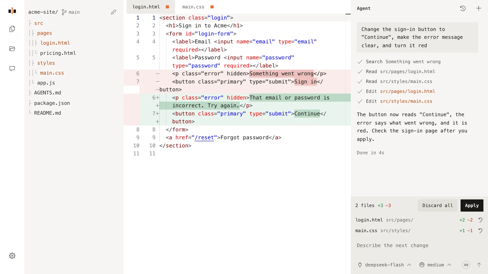
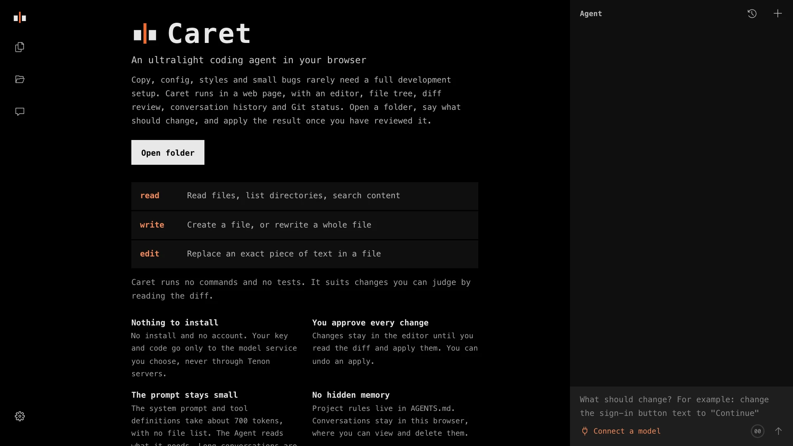
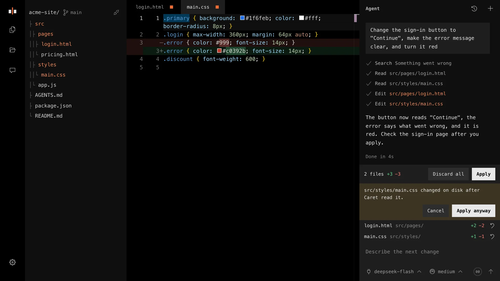
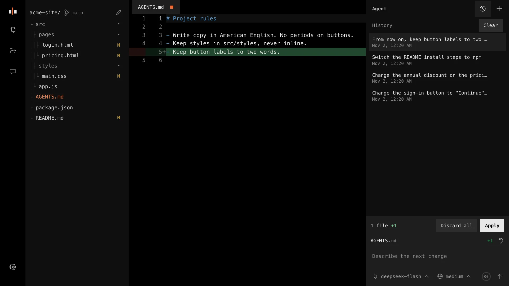
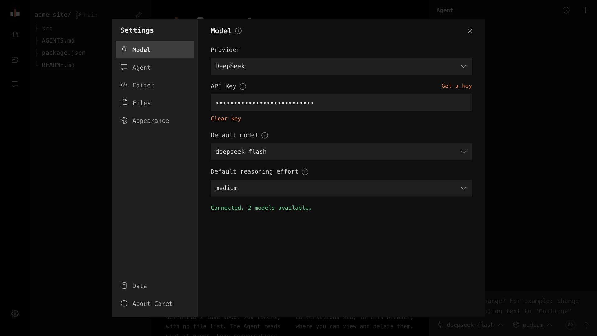

  

<h1 align="center">Caret</h1>

An ultralight coding agent in your browser

  
  

  <a href="https://tenonai.cn/products/caret/">Website</a> · <a href="https://caret.tenonai.cn/">Open Caret</a> · <a href="#documentation">Docs</a> · <a href="README.zh-CN.md">简体中文</a>

<picture>
  <source media="(prefers-color-scheme: dark)" srcset="docs/assets/review-en-dark.webp">
  
</picture>

Caret runs in your browser, with nothing to install and no account. Open a local folder and describe the change: the Agent edits the code in the editor, and nothing reaches the disk until you have read the diff. It suits changes you can judge from the diff, such as copy, styles, configuration, documentation and small bugs; it runs no code, so whether a change works is yours to check.

## Quick start

You need desktop Chrome or Edge, and an API key for a model service.

1. Open <https://caret.tenonai.cn/>
2. Choose a model service in Settings and enter your API key
3. Open or drop a folder, and describe the change
4. Read the diff, then click Apply or press `Ctrl/Cmd+Enter`. You can undo an apply

Other browsers cannot access local folders (the File System Access API), which is also why Caret has no mobile app. To run it locally, see [CONTRIBUTING.md](CONTRIBUTING.md).

## What it does

- **Three tools, no shell.** The Agent has `read`, `write` and `edit`; Caret runs no commands, runs no tests and never writes to `.git`.
- **Diff first, disk second.** Changes stay in a Monaco editor until you apply them, and apply and undo first check whether another program changed the file.
- **No hidden memory.** Project rules are `AGENTS.md` and `CLAUDE.md`, and a new rule is one more line you review like any other diff.
- **Your model and your key.** DeepSeek, Kimi, Qwen, OpenAI, OpenRouter or any OpenAI-compatible URL, with model lists and reasoning levels from the provider's `/models` API.
- **A small context.** The system prompt and tools take about 700 tokens, and compaction clears older tool results instead of asking the model for a summary.

## Screenshots

  
  
  
  

## Documentation

- [Changelog](CHANGELOG.md)
- [Contributing](CONTRIBUTING.md): running locally, tests and the project layout
- [Data inventory](docs/en/data-inventory.md)
- [Project conventions](AGENTS.md), [design guidelines](docs/design-guidelines.md) and the [security self-check](docs/security.md), in Chinese

## Where your data goes

Caret has no accounts and no application server: API keys, settings and conversations stay in this browser, and your requests and the files the Agent reads go only to the model service you choose. The [data inventory](docs/en/data-inventory.md) lists each item, where it is kept and how to delete it.

## Contributing

Bug reports, ideas and pull requests are welcome. Read [CONTRIBUTING.md](CONTRIBUTING.md) first. Everyone taking part follows the [Code of Conduct](CODE_OF_CONDUCT.md).

## Security

Please report security problems privately, as described in [SECURITY.md](SECURITY.md), and not in a public issue.

## License

[MIT](LICENSE). Copyright (c) 2025-2026 Tenon Artificial Intelligence Technology Co., Ltd.

The editor is [Monaco Editor](https://github.com/microsoft/monaco-editor), with the license in [vendor/monaco-0.52.2](vendor/monaco-0.52.2). Icons are from [vscode-codicons](https://github.com/microsoft/vscode-codicons), with the license in [css/codicons](css/codicons).

---

  Publisher&emsp;<a href="https://tenonai.cn/products/caret/"> <b>Tenon AI</b></a>

