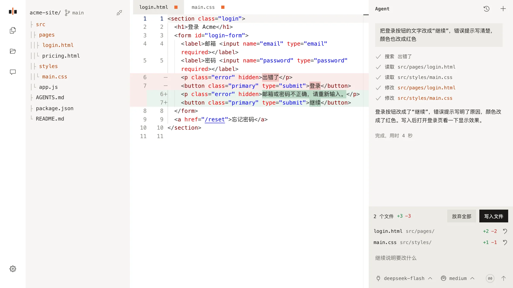
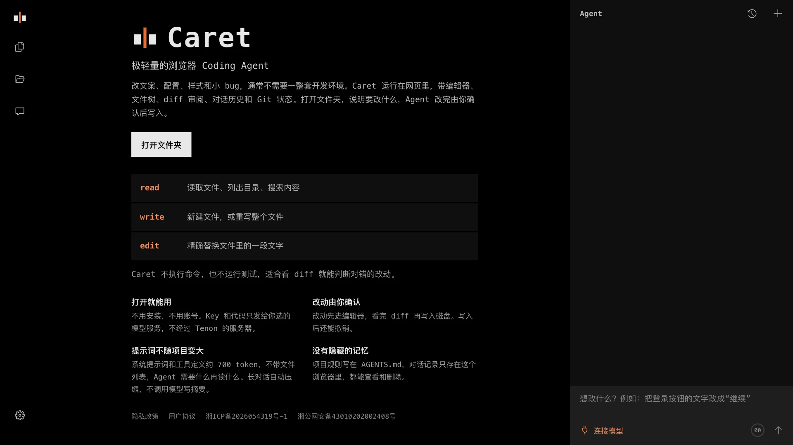
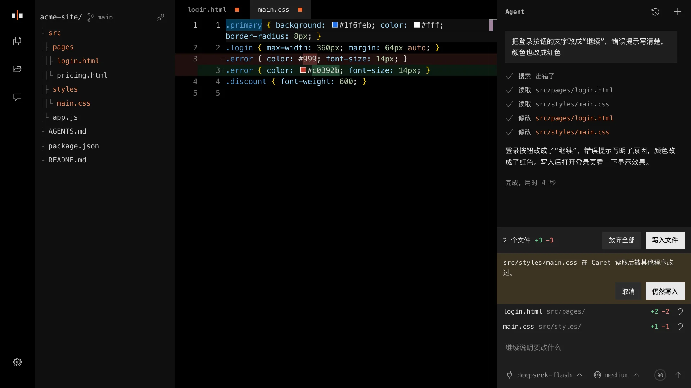
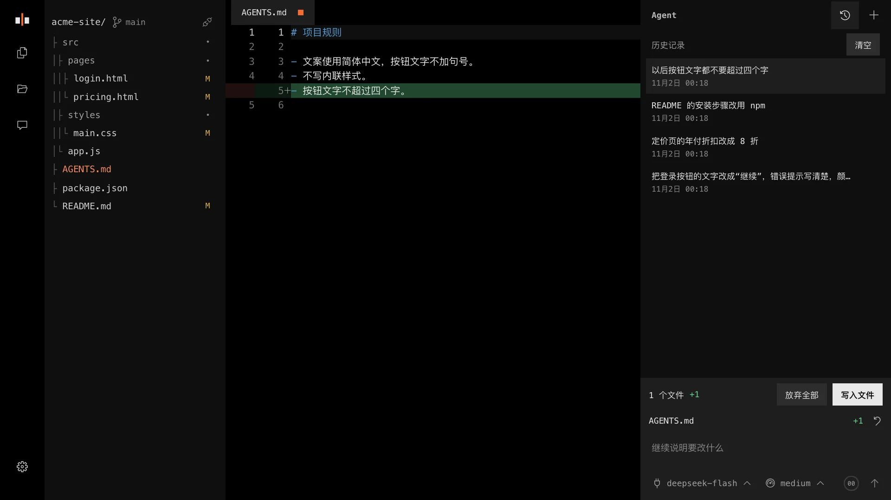
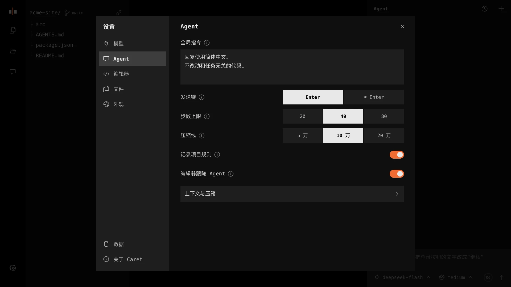

  

<h1 align="center">Caret</h1>

极轻量的浏览器 Coding Agent

<a href="README.md">English</a> | 简体中文

  
  

<picture>
  <source media="(prefers-color-scheme: dark)" srcset="docs/assets/review-zh-dark.webp">
  
</picture>

Caret 运行在浏览器里，不用安装，也不用账号。打开一个本地文件夹，说明要改什么，Agent 找到代码，在编辑器里做出改动。你看完 diff 写入之前，磁盘上的文件不会变。

## 能做什么

### 三个工具，没有 bash

Agent 只有 `read`、`write`、`edit`：`read` 读取文件、列出目录、搜索内容；`write` 新建文件，或重写整个文件；`edit` 精确替换文件里的一段文字，匹配到多处时拒绝修改。Caret 不执行命令，也不运行测试，适合改文案、配置、样式、文档和小 bug，这些改动看 diff 就能判断对错。需要跑起来才能确认的改动，它会告诉你该检查什么。

### 看完 diff 再写入磁盘

Monaco 编辑器，Agent 和你改的是同一份内容。Diff 支持行内和并排，可以直接编辑。写入和撤销前都检查磁盘内容，文件在 Caret 读取后被其他程序改过时先提示。文件树按 `.gitignore` 过滤，显示 Git 分支和改动标记。Git 状态只读，不提交，也不写入 `.git`。

### 没有隐藏的记忆

只有三样你能看到的东西。项目规则是运行时读取的 `AGENTS.md` 和 `CLAUDE.md`，你说出长期规则时，Agent 加一行，走同样的 diff 审阅。全局指令由你写在设置里，在所有项目生效。对话记录按项目保存在这个浏览器里，可以恢复、删除，也可以关闭保存。

### 用你自己的模型和 Key

内置 DeepSeek、Kimi、Qwen、OpenAI 和 OpenRouter，也可以填写 OpenAI 兼容的自定义地址。模型列表和推理档位都来自服务商的 `/models` 接口。设置里选默认值，输入栏可以为当前对话切换。

### 上下文很小

系统提示词和工具定义约 700 token，不带文件列表，Agent 需要什么再读什么。输入栏的小圈显示上下文已用比例，100% 是设置里的压缩线，默认约 10 万 token。到 100% 时，Caret 清理较早的工具结果，这些内容可以重新读取，所以压缩不调用模型写摘要。

## 快速开始

1. 用桌面版 Chrome 或 Edge 打开 <https://caret.tenonai.cn/>。其他浏览器不能访问本地文件夹
2. 在设置里选择模型服务，填写 API Key
3. 打开或拖入一个文件夹，说明要改什么
4. 看完 diff，点“写入文件”或按 `Ctrl/Cmd+Enter`。写入后可以撤销

Caret 只做网页版，不做手机应用：它要直接读写本地文件夹，目前只有桌面版 Chrome 和 Edge 支持这个能力（File System Access API）。在本地运行见 [CONTRIBUTING.md](CONTRIBUTING.md)。

## 文档

- [更新记录](CHANGELOG.md)
- [参与贡献](CONTRIBUTING.md)：本地运行、测试和目录结构
- [项目约定](AGENTS.md)和[设计规范](docs/design-guidelines.md)
- [安全自查](docs/security.md)

## 数据去向

- Caret 没有账号，也没有应用服务器
- 你的需求、全局指令和 Agent 读取的文件内容只发给你配置的模型服务
- `.env`、私钥、云服务和包管理工具的登录文件等常见密钥文件不会被读取
- API Key、设置和对话记录只保存在这台设备的浏览器里，可以在设置的数据页全部清除
- 访问线上地址时，服务器会记录访问日志，包括访问时间、IP 地址和访问的页面，不含网址参数，保存 6 个月后自动删除

数据清单

| 数据 | 来源 | 用途 | 保存位置和期限 | 删除方式 |
| --- | --- | --- | --- | --- |
| 模型服务设置和 API Key | 你在设置里填写 | 调用你选的模型服务 | 本机 IndexedDB，直到你删除 | 设置的数据页 |
| 偏好设置和全局指令 | 你在设置里填写 | 按你的偏好运行 | 本机 IndexedDB，直到你删除 | 恢复默认设置，或数据页 |
| 对话记录，含 Agent 读过的文件内容 | 你和 Agent 的对话 | 恢复和继续对话 | 本机 IndexedDB，每个项目最多 100 条 | 历史记录里删除，或数据页；可以关闭保存 |
| 发过的提示词 | 输入栏 | 按上下键找回 | 本机 IndexedDB，每个项目最多 200 条 | 数据页 |
| 文件夹访问授权和打开的标签页 | 你选的文件夹 | 下次打开时恢复 | 本机 IndexedDB，直到你删除 | 取消文件夹授权，或数据页 |
| 主题、语言和面板宽度 | 设置和界面操作 | 打开页面时直接按偏好显示 | 本机 localStorage，直到你删除 | 数据页 |
| 需求、全局指令，以及 Agent 读取的文件内容和路径 | 你的对话 | 完成任务 | 你选的模型服务，按它的隐私政策处理 | 按服务商的规则 |
| 访问日志：时间、IP 地址、访问的页面（不含参数）、状态码和耗时 | 访问线上地址 | 网络安全 | 服务器，6 个月后自动删除 | 到期自动删除 |

## 安全

发现安全问题，请按 [SECURITY.md](SECURITY.md) 私下报告，不要开公开的 issue。

## 参与贡献

欢迎报告问题、提建议和提交 PR，动手前先读 [CONTRIBUTING.md](CONTRIBUTING.md)。参与的人都遵守[行为准则](CODE_OF_CONDUCT.md)。

## 许可证

[MIT](LICENSE)。Copyright (c) 2025-2026 Changsha Tenon Artificial Intelligence Technology Co., Ltd.（长沙榫卯人工智能科技有限公司）

编辑器是 [Monaco Editor](https://github.com/microsoft/monaco-editor)，许可证见 [vendor/monaco-0.52.2](vendor/monaco-0.52.2)。图标来自 [vscode-codicons](https://github.com/microsoft/vscode-codicons)，许可证见 [css/codicons](css/codicons)。

---

  出品方　<a href="https://tenonai.cn/zh/products/caret/"> <b>榫卯 Tenon AI</b></a>

