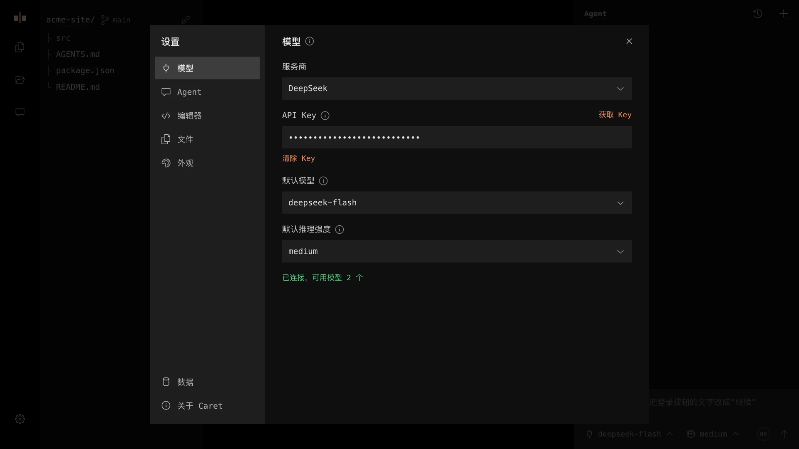

  

<h1 align="center">Caret</h1>

极轻量的浏览器 Coding Agent

  
  

  <a href="https://tenonai.cn/zh/products/caret/">官网</a> · <a href="https://caret.tenonai.cn/">打开 Caret</a> · <a href="#文档">文档</a> · <a href="README.md">English</a>

<picture>
  <source media="(prefers-color-scheme: dark)" srcset="docs/assets/review-zh-dark.webp">
  
</picture>

Caret 运行在浏览器里，不用安装，也不用账号。打开一个本地文件夹，说明要改什么，Agent 在编辑器里改代码，你看完 diff 写入之前，磁盘上的文件不会变。它适合改文案、样式、配置、文档和小 bug 这类看 diff 就能判断对错的改动；它不运行代码，改动是否可用要你自己检查。

## 快速开始

需要桌面版 Chrome 或 Edge，和一个模型服务的 API Key。

1. 打开 <https://caret.tenonai.cn/>
2. 在设置里选择模型服务，填写 API Key
3. 打开或拖入一个文件夹，说明要改什么
4. 看完 diff，点“写入文件”或按 `Ctrl/Cmd+Enter`。写入后可以撤销

其他浏览器不能访问本地文件夹（File System Access API），所以 Caret 也不做手机应用。在本地运行见 [CONTRIBUTING.md](CONTRIBUTING.md)。

## 能做什么

- **三个工具，没有 bash**：Agent 只有 `read`、`write`、`edit`，Caret 不执行命令、不运行测试，也不写入 `.git`。
- **先看 diff，再写磁盘**：改动先留在 Monaco 编辑器里，由你写入；写入和撤销前都检查文件有没有被其他程序改过。
- **没有隐藏的记忆**：项目规则就是 `AGENTS.md` 和 `CLAUDE.md`，新规则是多出的一行，和其他 diff 一样由你审阅。
- **用你自己的模型和 Key**：内置 DeepSeek、Kimi、Qwen、OpenAI、OpenRouter，也能填 OpenAI 兼容地址，模型列表和推理档位来自服务商的 `/models` 接口。
- **上下文很小**：系统提示词和工具定义约 700 token，压缩时清理较早的工具结果，不调用模型写摘要。

## 截图

  
  
  
  

## 文档

- [更新记录](CHANGELOG.md)
- [参与贡献](CONTRIBUTING.md)：本地运行、测试和目录结构
- [数据清单](docs/zh/data-inventory.md)
- [项目约定](AGENTS.md)、[设计规范](docs/design-guidelines.md)和[安全自查](docs/security.md)

## 数据去向

Caret 没有账号，也没有应用服务器：API Key、设置和对话记录只保存在这个浏览器里，你的需求和 Agent 读取的文件只发给你选的模型服务。每项数据存在哪里、怎么删除，见[数据清单](docs/zh/data-inventory.md)。

## 参与贡献

欢迎报告问题、提建议和提交 PR，动手前先读 [CONTRIBUTING.md](CONTRIBUTING.md)。参与的人都遵守[行为准则](CODE_OF_CONDUCT.md)。

## 安全

发现安全问题，请按 [SECURITY.md](SECURITY.md) 私下报告，不要开公开的 issue。

## 许可证

[MIT](LICENSE)。Copyright (c) 2025-2026 Tenon Artificial Intelligence Technology Co., Ltd. (长沙榫卯人工智能科技有限公司)

编辑器是 [Monaco Editor](https://github.com/microsoft/monaco-editor)，许可证见 [vendor/monaco-0.52.2](vendor/monaco-0.52.2)。图标来自 [vscode-codicons](https://github.com/microsoft/vscode-codicons)，许可证见 [css/codicons](css/codicons)。

---

  出品方　<a href="https://tenonai.cn/zh/products/caret/"> <b>榫卯 Tenon AI</b></a>

